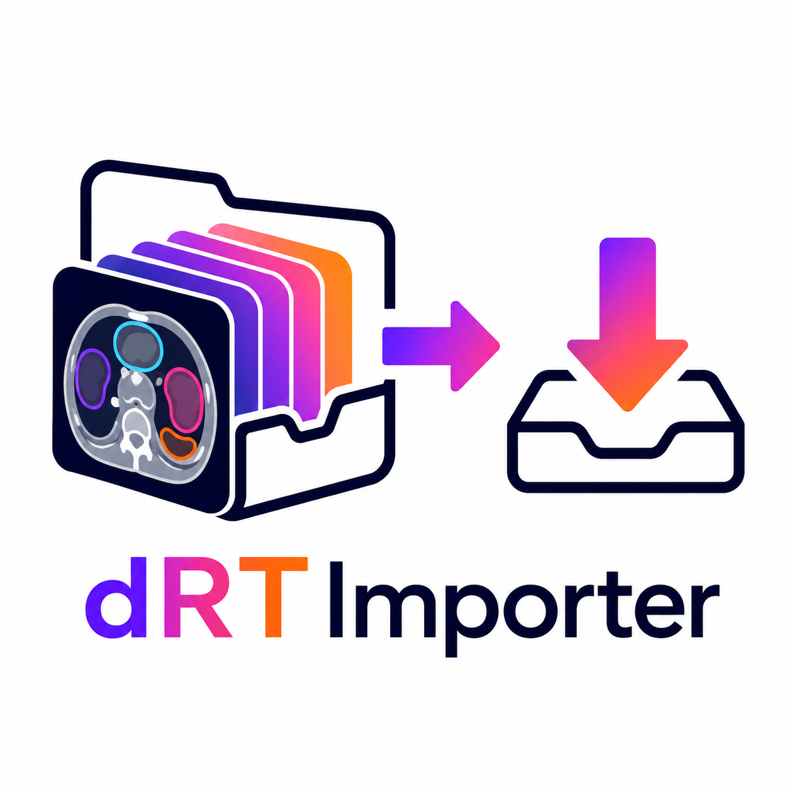

# dRTImporter

<p align="center">
  
</p>

| **Author** | **Project** |
| :---: | :---: |
| [**Daniele Dall'Olio**](https://github.com/DanieleDallOlio) | dRTImporter |

**dRTImporter** is a [3D Slicer](https://www.slicer.org/) DICOM import plugin for supported **dynamic RT Structure Sets (RTSTRUCTs)**. It reconstructs temporally varying ROI contours as **Slicer segmentation sequences** and includes Python helpers for exporting both dynamic and conventional static RTSTRUCT objects.

It is maintained separately and included as a Git submodule of [SlicerDynamicPET](https://github.com/DanieleDallOlio/SlicerDynamicPET).

> **Important: temporal RTSTRUCTs are nonstandard.** DICOM RT Structure Set Storage does not define a general standardized representation for time-varying contours. dRTImporter supports specific conventions, including a MiM-style temporal-reference convention and a versioned private mapping for Enhanced PET. Successful import or export does **not** guarantee interoperability with every DICOM application. Validate a representative round trip before research production use; this software is not a medical device.

## Scope

The DICOM plugin:

- recognizes supported **dynamic** RTSTRUCT objects while avoiding false positives on ordinary static RTSTRUCTs;
- reads DICOM contours and creates temporal `vtkMRMLSegmentationNode` states in a `vtkMRMLSequenceNode`;
- synchronizes with a compatible PET Volume Sequence/Sequence Browser when source-image provenance matches unambiguously;
- otherwise creates a standalone segmentation sequence/browser without guessing the corresponding PET acquisition.

The package also contains programmatic **RTSTRUCT exporters** used by SlicerDynamicPET:

- **dynamic export:** one temporal RTSTRUCT for a PET Volume Sequence and its associated segmentation sequence;
- **static export:** one conventional RTSTRUCT for a scalar PET volume and its segmentation.

Ordinary static RTSTRUCT **import** remains the responsibility of [SlicerRT](https://github.com/SlicerRt/SlicerRT). dRTImporter does not add an independent static RTSTRUCT DICOM loadable and does not export DICOM directly from the Slicer DICOM module's UI. It does not perform motion correction or kinetic modeling.

## Supported temporal conventions

### Conventional PET with a temporal reference convention

For compatible conventional dynamic PET series, the plugin interprets `Referenced Frame Number (0008,1160)` as a **one-based PET temporal frame index** only after strict validation.

Key requirements include:

1. A DICOM object with `Modality = RTSTRUCT` and RT Structure Set Storage SOP Class.
2. At least two temporal frame indices forming a consecutive `1..N` sequence.
3. Every referenced PET SOP Instance UID belongs to **exactly one temporal state**.
4. Each temporal state references **one or more** PET SOP instances.

The final point permits both a PET acquisition stored as **one 3D SOP per time point** and one stored as **multiple 2D slice SOPs per time point**. The importer may obtain the complete mapping from the referenced-series `ContourImageSequence` and the active ROI assignments from individual contour references.

This validation is deliberately conservative. Referencing multiple spatial frames of a conventional *static* multiframe image must not, by itself, cause the object to be classified as a dynamic RTSTRUCT.

### Enhanced single-SOP PET

Enhanced PET can store many spatial slices and temporal PET volumes in **one multiframe SOP Instance**. In that case, a DICOM `Referenced Frame Number` denotes a **real spatial source-image frame**, not an independently identifiable temporal PET volume.

For this organization, dRTImporter uses a **versioned SlicerDynamicPET private temporal mapping** (`EnhancedPrivateTemporalMapV1`) alongside genuine Enhanced PET source-frame references. The importer validates the mapping, the source SOP identity, the referenced series/frame-of-reference information, and contour-to-temporal-plane assignments.

The private convention is intentional: it does not reinterpret real Enhanced PET frame numbers as temporal indices. It requires a compatible producer and is **not a universal DICOM interchange standard**.

## Import implementation

The current importer uses a **one-pass contour workflow**:

1. Read and validate the RTSTRUCT once with `pydicom`.
2. Index ROI definitions and `CLOSED_PLANAR` contours by supported temporal state.
3. Build Slicer segmentation states using the **Planar contours** representation, preserving patient-space contour coordinates.
4. Create a segmentation sequence and proxy and attach them to an existing compatible PET browser, or create a standalone browser.
5. Generate derived Binary labelmap representations **on demand** when later editing or quantitative workflows require them.

**Unlike older versions, the importer does not create a temporary RTSTRUCT for every time point and does not invoke the SlicerRT DICOM loader separately for each temporal frame.** This design reduces repeated conversion work and retains the source Planar contours representation.

### Synchronization to PET

For conventional dynamic PET, the importer seeks an **unambiguous match** using the referenced PET Series Instance UID and per-timepoint SOP Instance UID sets. For Enhanced PET, it checks the persisted **full SOP/frame-number mapping** and spatial provenance.

If no unique compatible PET browser exists, the segmentation is imported **standalone**. A mere match in frame count is not considered sufficient for automatic synchronization. A later explicit adoption/synchronization workflow may be available from SlicerDynamicPET.

If SlicerRT is missing, Planar contours may still be loaded, but conversion to Binary labelmaps or some downstream segmentation operations may be unavailable or limited. Installing **SlicerRT** is strongly recommended for the full workflow.

## RTSTRUCT export

The exporters are implemented in `dRTImporterLib/dRTExporter.py`, and SlicerDynamicPET invokes them through a Python bridge.

### Dynamic RTSTRUCT export

The dynamic exporter:

- requires a PET sequence and its temporal segmentation sequence;
- resolves source PET DICOM references from persisted dPETImporter provenance, with defined fallbacks for supported conventional PET;
- validates temporal frame correspondence, DICOM source identity, and Frame of Reference;
- extracts `CLOSED_PLANAR` contours from Binary representations when needed;
- reuses identical ROI geometry states where possible while retaining their temporal references;
- validates the assembled RTSTRUCT before writing the DICOM file with `pydicom`.

For **Enhanced single-SOP PET**, the export path uses the genuine DICOM source spatial frame numbers plus the versioned private temporal map. Enhanced export requires compatible persisted `dPET.DICOM.FrameReferences` provenance, including the supported schema and source identity; reimport the original PET with a current compatible dPETImporter if this is missing.

### Static RTSTRUCT export

The static exporter writes a conventional RTSTRUCT referencing the **original static PET source images**. It requires the scalar PET volume to expose `DICOM.instanceUIDs` and the corresponding instances to remain accessible through the Slicer DICOM database. It supports conventional slice SOPs and recognized multiframe spatial source references.

It is not enough for the scalar volume alone to exist in the MRML scene if the original DICOM references are no longer resolvable.

### Multi-timepoint batch export in SlicerDynamicPET

When two or more PET acquisitions have been validated and prepared in SlicerDynamicPET's Multi-timepoint mode, **Save Multi RTSTRUCTs** writes **one file per acquisition**:

```text
RTSTRUCT_Acq01_Dynamic.dcm
RTSTRUCT_Acq02_Static.dcm
```

Dynamic acquisitions use temporal export; static acquisitions use conventional static export. The merged ROI TAC is **not** turned into a fictional combined PET DICOM series. If a later file in a batch fails to export, previously written files are retained and the application reports partial progress.

## Requirements

- 3D Slicer, including its DICOM, Sequences, and Segmentations infrastructure.
- Python `pydicom` in Slicer's Python environment.
- Slicer's bundled VTK and NumPy for segmentation conversion/contour extraction and export.
- **SlicerRT** strongly recommended for compatible RT segmentation/conversion infrastructure and for importing conventional static RTSTRUCTs.

The current RTSTRUCT exporter does **not** depend on the separate `rt-utils` Python package.

## Installation

### As part of SlicerDynamicPET

Use a compatible [SlicerDynamicPET](https://github.com/DanieleDallOlio/SlicerDynamicPET) source build or extension package. For a source checkout, initialize submodules:

```bash
git submodule update --init --recursive
```

SlicerDynamicPET's extension configuration includes SlicerRT as a dependency.

### Standalone development build

```bash
git clone https://github.com/DanieleDallOlio/dRTImporter.git
cmake -S dRTImporter -B dRTImporter-build -DSlicer_DIR=/path/to/Slicer-build
cmake --build dRTImporter-build --config Release
```

The repository is a scripted Slicer module, but it still needs to be installed or added to a compatible Slicer module path for its DICOM plugin to register.

For development without extension packaging, add the inner module directory `dRTImporter/dRTImporter` to Slicer's additional module paths and restart Slicer. Make sure the `dRTImporterLib` package and exporter helpers are available alongside the module as configured by its CMake file.

## Using the DICOM importer

1. Install/enable **SlicerRT** and dRTImporter.
2. Import the relevant dynamic PET data and the dynamic RTSTRUCT into Slicer's DICOM database.
3. Prefer loading the PET sequence first, so provenance-based synchronization can be attempted.
4. Select the DICOM loadable labeled **`[Dynamic RTSTRUCT] (N frames)`**.
5. If a separate SlicerRT static RTSTRUCT loadable is also offered for the same object, deselect that static loadable when only the temporal interpretation is wanted.
6. Load the dynamic RTSTRUCT and inspect the resulting segmentation sequence and browser.
7. Verify the frame mapping, source-image geometry, ROI identities, and temporal contours before analysis or export.

A progress dialog is used during importing and conversion, with support for cancellation.

## MRML output and metadata

The importer creates a `vtkMRMLSequenceNode` of segmentation snapshots, a segmentation proxy, and a compatible or standalone `vtkMRMLSequenceBrowserNode`.

Selected metadata attributes include:

```text
dRTImporter.DynamicRTStruct
dRTImporter.Convention
dRTImporter.SourceFile
dRTImporter.SourceRepresentation
dRTImporter.FrameToSOPInstanceUIDs
dRTImporter.ReferencedSeriesInstanceUID
dRTImporter.FrameNumber
```

For supported Enhanced PET, additional provenance includes:

```text
dRTImporter.EnhancedSourceFrameNumbers
dRTImporter.EnhancedSourceSOPInstanceUID
dRTImporter.ReferencedFrameOfReferenceUID
```

Attributes are attached to the relevant sequence, proxy, or temporal state as appropriate. Their presence and values depend on the loaded convention and available provenance.

## Limitations and validation

- Temporal RTSTRUCT encoding remains **vendor-/project-specific** and requires producer/consumer agreement.
- Ordinary static RTSTRUCTs are not imported by this plugin; use **SlicerRT**.
- Only compatible contours and temporal-reference mappings are accepted; unsupported contour geometry may be skipped or rejected.
- Automatic PET synchronization requires a unique source-provenance match; matching the number of frames alone is not sufficient.
- Dynamic export requires valid temporal PET provenance. Enhanced single-SOP round trips require the supported private temporal map and source frame references.
- Static export requires access to the original PET DICOM instances.
- Always verify exported files by reimporting them, examining all temporal ROI states, and testing compatibility with the external application actually intended to consume them.

Import/export should be independently validated against representative datasets, including MiM-style conventional temporal RTSTRUCTs and Enhanced PET single-SOP cases, before production research use.

## Repository structure

```text
dRTImporter/
|-- CMakeLists.txt
|-- dRTImporter.png
|-- LICENSE
|-- README.md
`-- dRTImporter/
    |-- CMakeLists.txt
    |-- dRTImporter.py
    `-- dRTImporterLib/
        |-- __init__.py
        |-- dRTImporterPlugin.py
        |-- dRTEnhancedTemporal.py
        `-- dRTExporter.py
```

## DICOM references

- [DICOM Image Reference Macro](https://dicom.nema.org/medical/dicom/current/output/chtml/part03/sect_c.18.4.html)
- [DICOM ROI Contour Module](https://dicom.nema.org/medical/dicom/current/output/chtml/part03/sect_c.8.8.6.html)
- [DICOM Structure Set Module](https://dicom.nema.org/medical/dicom/current/output/chtml/part03/sect_c.8.8.5.html)

## License

dRTImporter is distributed under the **MIT License**. See [LICENSE](LICENSE).

## Author

**Daniele Dall'Olio**  
University of Bologna

- [GitHub](https://github.com/DanieleDallOlio)
- [University profile](https://www.unibo.it/sitoweb/daniele.dallolio)

## Acknowledgments

dRTImporter relies on the 3D Slicer ecosystem, especially the DICOM, Sequences, Segmentations, VTK, and SlicerRT infrastructure maintained by their respective contributors.
